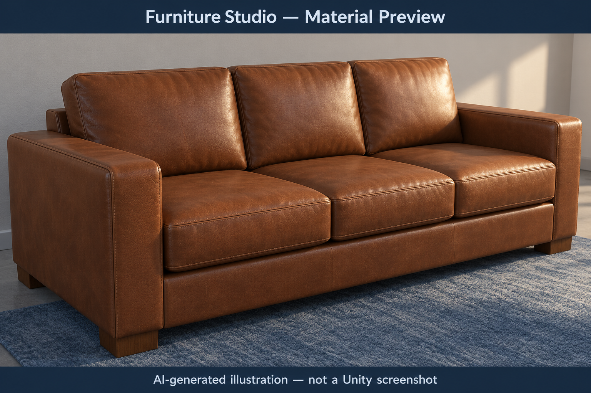

# CGVR CIE3 | Case Study 3: Retail and Remote Commerce

**Student:** MANDAR JOSHI
**USN** 1RVU23CSE23
**University:** RV University  
**Course:** CS4104 - Computer Graphics & Virtual Reality  
**Case-study title:** Case Study 3: Retail and Remote Commerce  
**Implementation:** Unity 6000.3.0f1 (Built-in Render Pipeline)

## Submission overview

The primary practical component is the **existing Unity furniture visualizer** at [Unity_Retail_AR_Demo](Unity_Retail_AR_Demo/README.md). It uses a procedural room with a red chair and brown leather sofa to demonstrate the three graphics principles requested by the faculty: Phong illumination, texture/bump mapping and window-to-viewport transformation. It is a **desktop 3D simulation of retail AR/VR graphics techniques**, **not** a functioning device-tracked AR application or deployed WebXR application.

- [Unity implementation instructions and controls](Unity_Retail_AR_Demo/README.md)
- [Unity-specific case-study report](UNITY_CASE_STUDY_REPORT.md)
- [Evidence folder and genuine screenshot capture guide](outputs/README.md)
- [Supplementary conceptual/Python case study](CASE_STUDY_REPORT.md)

## Open and demonstrate the Unity application

1. Download/extract the repository. Open **Unity Hub -> Add -> Add project from disk** and select **`CASE STUDY CIE3/Unity_Retail_AR_Demo`**, the folder containing `Assets`, `Packages`, and `ProjectSettings`.
2. Open in **Unity Editor 6000.3.0f1**. Wait for compilation and import to finish; use the **Built-in Render Pipeline**. No additional packages or model downloads are required.
3. Select **CGVR CIE3 -> Open Furniture Visualizer**. Alternatively open `Assets/Scenes/CIE3_Retail_Furniture_Visualizer.unity`. **Do not select Rebuild** unless the existing scene is actually missing.
4. Press **Play**, select the **Game** tab, and use a desktop landscape size such as **1440 x 900**. The furniture and GUI are constructed at runtime, so the scene hierarchy may look sparse before Play.
5. Present the chair and sofa together. Press **1**, **2**, **3** for ambient-only, ambient+diffuse and ambient+diffuse+specular. Select **Sofa**, press **F** to focus, then toggle **T** for color texture and **B** for bump/normal map. Press **R** for the full room.
6. Press **V** to show viewport mapping and **Reset point** to demonstrate **(0.25, -0.30) -> (657.5, 708.0) pixels** in the example phone viewport. Press **Inset viewport** to also alter the real Game-view camera rectangle; this is separate from the illustrative phone coordinates.
7. Drag **in the scene** to orbit, scroll to zoom, and use Left/Right arrows to turn the selected furniture. You may use **CGVR CIE3 -> Validate Scene and Mapping** to perform the built-in shader/scene/mapping check in your own editor; its output is **not claimed as run here**.

### Assignment concepts

| Faculty question | Relevant graphics principle | What the Unity code demonstrates |
| --- | --- | --- |
| How does a red chair respond to indoor/daylight illumination? | **Phong illumination**: ambient, Lambert diffuse and view-dependent specular light | A custom `CGVR/PhongFurniture` shader; keys **1/2/3** and daylight/specular controls |
| How can a leather sofa gain surface detail without extra polygons? | **UV texture** for surface colors, **normal/bump mapping** for perturbed shading normals | Runtime leather albedo and normal textures; independently controlled **T/B** toggles |
| How are interaction coordinates mapped to a phone/headset viewport? | **Window-to-viewport transformation** after projection | Normalized `[-1,1]` window, phone example and separate real camera inset |

**Phong (conceptual):** `I = Ia*ka + Ip*[kd*max(N.L,0) + ks*max(R.V,0)^n]`. The actual fragment shader calculates ambient, diffuse and specular RGB terms, modulates diffuse/ambient by albedo and uses per-pixel normals.

**Window to viewport:**

```text
xv = xv_min + (xw - xw_min) * (xv_max - xv_min) / (xw_max - xw_min)
yv = yv_min + (yw - yw_min) * (yv_max - yv_min) / (yw_max - yw_min)
Window: x,y = [-1,1]; phone viewport: x=[70,1010], y=[120,1800]
Point: (0.25,-0.30) -> (657.5,708.0) pixels
```

## Actual Unity screenshot evidence

**Evidence status as of 18 October 2026: genuine Game-view screenshots have not been supplied or committed.** The `outputs/` directory contains [instructions and exact capture names](outputs/README.md), not falsely labeled renders. Add genuine captures there before faculty submission:

1. `unity_01_room_overview.png`: complete red chair and brown sofa, Game tab in Play mode.
2. `unity_02_phong_ambient.png` and `unity_03_phong_full.png`: same view with lighting modes 1 and 3.
3. `unity_04_sofa_texture_off.png` and `unity_05_sofa_texture_on.png`: focused sofa, texture off/on with otherwise matching controls.
4. `unity_06_sofa_bump_off.png` and `unity_07_sofa_bump_on.png`: mode 3, matching angle and texture, bump off/on.
5. `unity_08_viewport_mapping.png`: mapping panel, Reset point and 657.5 / 708.0 values visible.
6. `unity_09_inset_viewport.png`: actual inset viewport, room and screen marker visible.

Once uploaded, embed verified files with e.g. ``. **Do not interpret the example filename as proof the file exists.**

## Concept previews (not Unity output)

The following images are **AI-generated illustrations** and **must never be submitted as measured outputs or Unity screenshots**:




## Supporting files and limits

- `UNITY_CASE_STUDY_REPORT.md` documents the implemented Unity simulation, procedure, limitations and evidence status.
- `CASE_STUDY_REPORT.md`, `case_study_3_retail_ar.py` and `case_study_3_retail_ar.ipynb` are **earlier Python/conceptual work**, not Unity test evidence. Python plots described there are generated only after running the script and are not presently committed to `outputs/`.
- No hardware AR tracking, measured Unity FPS, mobile deployment, automated Unity runtime verification or genuine screenshots are claimed.
- Only the submission documentation needs revision; the working `Unity_Retail_AR_Demo/Assets`, `Packages` and `ProjectSettings` remain unchanged.
